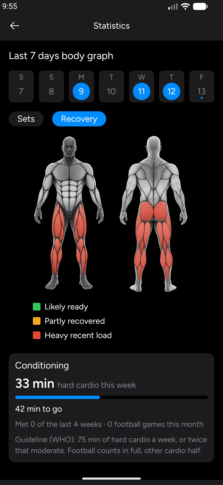

<p align="center">
  
</p>

<p align="center">
  <a href="https://github.com/hamzaamry/hevier/actions/workflows/check.yml"></a>
  <a href="https://sonarcloud.io/summary/new_code?id=hamzaamry_hevier"></a>
  <a href="https://sonarcloud.io/summary/new_code?id=hamzaamry_hevier"></a>
  <a href="LICENSE"></a>
  
</p>

<p align="center">
  <b>A free, open-source workout tracker that shows what your training does to each muscle.</b><br>
  Lifting and cardio. On your phone only. No account, no ads, no subscription.
</p>

<table align="center">
  <tr>
    <td align="center"><b>All features free</b><br><sub>no paywall, no lock icons</sub></td>
    <td align="center"><b>Offline, private</b><br><sub>SQLite on the phone, PC backup</sub></td>
    <td align="center"><b>Cited science</b><br><sub>every rule names its study</sub></td>
  </tr>
  <tr>
    <td align="center"><b>Recovery map</b><br><sub>lifting <i>and</i> cardio</sub></td>
    <td align="center"><b>5,600+ exercises</b><br><sub>from openGym</sub></td>
    <td align="center"><b>Works when closed</b><br><sub>notification timer, 4 widgets</sub></td>
  </tr>
</table>

<table align="center">
  <tr>
    <td align="center" valign="top"><br><sub><b>Home</b> · next in your cycle</sub></td>
    <td align="center" valign="top"><br><sub><b>Log Workout</b> · rest timer, last session's numbers</sub></td>
    <td align="center" valign="top"><br><sub><b>Recovery map</b> · what's ready to train</sub></td>
  </tr>
</table>

> **Unofficial.** Hevier is a hobby project inspired by the Hevy app. It is not
> affiliated with, endorsed by or connected to Hevy or its makers. "Hevy" is
> their trademark. Hevier contains no Hevy code or assets.

## Features

### Logging
- **Fast sets:** weight and reps, time or distance, plus warm-up and failure sets
- **Rest timer** per exercise, with a clock, a stopwatch and Keep Awake
- **Live PR medals:** weight, e1RM, volume, reps, time, distance
- **"Reps left"** after your last set, so the app knows how hard it was
- **Per-hand weight** for dumbbell exercises
- **Past workouts:** edit, copy or delete, log one for a past day, save as a routine

### Routines and cycle
- Routines in folders, reordered by drag and drop
- A **training cycle** (Upper A → Lower A → Upper B → …) that tells you what's
  next, on Home and in a widget
- After a workout, offers to update the routine with what you actually did

### Statistics, all free

<table align="center">
  <tr>
    <td align="center" valign="top"><br><sub><b>Body graph</b> · sets per muscle this week</sub></td>
    <td align="center" valign="top"><br><sub><b>Muscle distribution</b> · vs. the period before</sub></td>
    <td align="center" valign="top"><br><sub><b>Advanced statistics</b> · no lock icons</sub></td>
  </tr>
</table>

- **Body graph:** this week's sets per muscle, from below maintenance to growth
- **Recovery map:** what's ready to train, after [lifting and cardio](#cardio-counts-too)
- **Muscle distribution** radar and **push / pull balance**, with a warning
- **Monthly report** and set counts per muscle group

<table>
<tr>
<td valign="top">

### Based on research, not guesses
- **Hard sets count.** At or within 3 reps of failure = 1 set; easier counts less (Robinson 2024).
- **Helpers count half.** Triceps in a bench press = ½ set (Pelland 2024).
- **Zones with sources.** 3 hard sets/week **maintain** (Bickel 2011); 4+ **grow** (Pelland 2024).
- **Recovery from studies.** 1 hard set ≈ a day tired; 4+ up to three days.

An estimate, labelled as one. Gaps are written down in [`docs/science/`](docs/science/).

</td>
<td width="250" valign="top"></td>
</tr>
<tr>
<td valign="top">

### Cardio counts too
- **Six activities:** sprints, running, hiking, walking, tennis, football.
- **Each loads its own muscles:** the legs for all; the shoulders too for tennis.
- **Tap Easy, Normal or Hard.** Skipping the tap counts as Normal.
- **Longer tires more,** but less per minute.
- **Rest timer off** by default.
- **Conditioning card:** weekly minutes vs. the WHO guideline, without pushing for more.

The cardio numbers are estimates, not study results: [`recovery.md`](docs/science/recovery.md).

</td>
<td width="250" valign="top"></td>
</tr>
<tr>
<td valign="top">

### 5,600+ exercises
- Barbell, dumbbell, cable, machine, band and bodyweight versions.
- Muscles and step-by-step instructions ([openGym](#credits)).
- Search by name; filter by equipment or muscle.
- Each exercise has a page with your chart, records and history.

</td>
<td width="250" valign="top"></td>
</tr>
</table>

### Notification and widgets

<table align="center">
  <tr>
    <td align="center" valign="top"><br><sub><b>Workout notification</b> · next set and rest countdown, with Complete Set, Skip, -15s and +15s, even in the background</sub></td>
    <td align="center" valign="top"><br><sub><b>Home-screen widgets</b> · calendar, weekly volume, next in cycle, recovery map</sub></td>
  </tr>
</table>

### Your data
- **Import** your history from a Hevy CSV export
- **Hevier Sync**: a small PC program that keeps a backup of the phone over
  Wi-Fi or a USB cable, and can restore it
- Everything lives on the phone: no account, no server, no tracking

<sub>Screenshots use demo data. Exercise pictures aren't part of this repository
(see [Exercise pictures](#exercise-pictures)), so the app shows a placeholder
instead.</sub>

## Getting started

You need Node.js 22+, [pnpm](https://pnpm.io) (`corepack enable` gives you the
right version), the Android SDK, and an emulator or an Android phone with
USB debugging on. The app has its own native modules, so it doesn't run in
Expo Go: build it once with

```bash
pnpm install
pnpm android        # expo run:android, from apps/mobile
```

After that, `pnpm mobile` (`expo start`) serves code changes to the installed app.

Checks (types, lint, tests, for every package through Turborepo):

```bash
pnpm check
```

They also run before every commit: `pnpm install` turns on the git hook in
`.githooks/pre-commit`.

### Import your Hevy history (optional)

In Hevy, export your workouts as CSV, then with the device connected:

```bash
apps/mobile/scripts/load-device.sh path/to/workouts.csv
```

This **replaces** the app's data on the device. Hevy's export has workouts
only, so make your routines in the app.

<details>
<summary>Import details</summary>

- **Units:** pounds and miles are converted to kg and km.
- **Time zone:** Hevy's dates have no time zone, so they're read in this
  computer's zone (printed when the import runs). If you trained elsewhere:
  `HEVIER_TIMEZONE=Europe/Paris scripts/load-device.sh path/to/workouts.csv`
- **No numbers:** an exercise logged without weight, reps, time or distance
  (like Stretching) is left out, and the import says so.
- **Bad rows:** skipped and listed.
- **Safety:** if nothing can be read, or more than 1 row in 10 is skipped,
  the import stops and your app's data is left alone.

</details>

### Exercise pictures

The exercise stills and clips are licensed by Gym visual to openGym only, so
they are **not** in this repository. Without them the app shows a placeholder.
If you have your own licensed copy, put it in `packages/catalogue/media/` and
`apps/mobile/scripts/load-device.sh` copies it onto the device.

### Hevier Sync (PC backup)

```bash
pnpm install
pnpm sync
```

Scan the QR code it shows from the app (Profile → Settings → Sync with PC).
Backups go to `~/HevierBackup`. Settings, what it keeps and its safety model:
[apps/sync/README.md](apps/sync/README.md).

### Release build on your phone

```bash
cd apps/mobile
npx expo prebuild --platform android
(cd android && ./gradlew assembleRelease)
adb install -r android/app/build/outputs/apk/release/app-release.apk
```

`install -r` installs over the old app and keeps its data. The build is signed
with the key described in `~/.config/hevier/keystore.properties` (`storeFile`,
`storePassword`, `keyAlias`, `keyPassword`), or with the debug key if that file
doesn't exist. Keep your key safe: an update signed with another key can't be
installed over the old app, and uninstalling wipes its data.

A release build isn't debuggable unless you prebuild with `HEVIER_DEBUGGABLE=1`.
`apps/mobile/scripts/load-device.sh` needs that to copy data in, but it also lets anyone
with the phone on USB read the app's data.

## Contributing

Pull requests are welcome. [CONTRIBUTING.md](CONTRIBUTING.md) has the code
rules, the [repo layout](CONTRIBUTING.md#repo-layout) and the checks to run first.

## Licence

Hevier is free software under the [GNU AGPL v3.0](LICENSE). The bundled exercise
catalogue comes from openGym, which is AGPL too.

## Credits

See [THIRD-PARTY-NOTICES.md](THIRD-PARTY-NOTICES.md) for the full list:

- Exercise catalogue: [openGym](https://github.com/DuarteSantos8/openGym) (AGPL-3.0),
  partly from ExerciseDB via hasaneyldrm/exercises-dataset (MIT)
- Body map: [MuscleMap](https://github.com/Jsplice/MuscleMap) (MIT)
- Figtree font (SIL Open Font License), Phosphor icons (MIT), Lucide icon (ISC)
